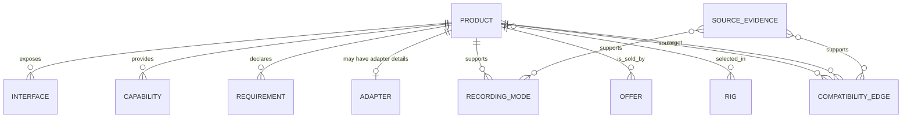

# Data model

## Packages

- `@creatorrig/domain` contains dependency-free TypeScript vocabulary and entity contracts.
- `@creatorrig/data-schema` contains strict Zod schemas for imported and generated JSON.

All imported data must cross `parseCreatorRigDataSet` or the corresponding entity schema. Schemas reject unknown keys to expose source drift rather than silently discard it.

## Identity, time, and units

- IDs are stable, globally unique ASCII identifiers. An ID does not contain mutable display text semantics.
- Dates are ISO 8601 timestamps with an explicit offset.
- Weight is stored in grams.
- Dimensions are stored in millimetres.
- Voltage, current, and power use V, A, and W.
- Bitrate is Mbps; sustained media write is also Mbps.
- Money uses integer minor units and an ISO 4217 currency code.
- Capacity values use the unit explicitly named by the field. Calculators own decimal/binary conversion rules.

Unknown values are omitted. Zero is not a substitute for unknown. Calculations must return missing-input diagnostics instead of guessing.

## Entity relationships



`Adapter.productId` points at an ordinary product. `CompatibilityEdge.requiredAdapterIds` contains adapter product IDs, so a shopping list and a path use one identity.

## Declarative conditions

Conditions contain only:

- `factPath`: a dot-delimited path accepted by an evaluator allowlist;
- `operator`: a controlled comparison operator;
- JSON `value` when the operator requires one.

Imports cannot contain JavaScript, templates, callbacks, selectors, or URLs to execute. Evaluation code must reject unknown fact paths.

## Compatibility edge invariants

An edge contains source and target product IDs, direction, scope, relation type, one or more unique dimension results, required adapters, limitations, conditions, evidence, verification state, publication state, and verification date.

Schema-level rules include:

- self-edges are rejected;
- `compatible_with_adapter` names at least one defined adapter product;
- a candidate cannot be verified or public;
- unknown and deprecated edges cannot be public;
- verified edges require evidence and `verifiedAt`;
- public edges must be verified and evidenced;
- each asserted public dimension has evidence;
- referenced public evidence is verified and covers the asserted dimension;
- positive public electrical claims have verified official electrical evidence.

These are publication gates, not a complete compatibility evaluator. The evaluator must still interpret all dimensions and requirements.

## Evaluation aggregation invariant

Every module returns independent dimensions plus one summary status produced by the canonical aggregator described in ADR 0010. Evidence completeness is checked before either positive or negative publication; without scoped proof the result is `unknown`. After that gate, an explicit incompatible dimension wins over an unknown one, an unknown dimension wins over a limitation, and limitations win over adapter/direct success. `not_applicable` does not fail an evaluation. Product and edge records never store a runtime-computed boolean compatibility value.

## Source evidence

Evidence records source type, HTTP(S) URL, access/publication dates, proof scope, supported claims, notes, verifier, verification status, and archive URL. `proofScope` prevents a mechanical claim from being reused as proof of autofocus, signal, or power compatibility.

Official manuals, compatibility lists, product specifications, adapter documentation, and firmware documentation are primary sources. Independent tests may supplement them. Positive electrical publication requires an official source.

## Dataset validation

`CreatorRigDataSetSchema` validates records and cross-references. In addition to entity validation it checks globally unique IDs, product references, adapter definitions, evidence verification/scope, recording-mode ownership, offers, and rig product selection.

Dataset validation runs before graph generation. Generated graph/search files are disposable build artifacts and are never the source of truth.

## Versioning and migrations

The dataset has a semantic `schemaVersion`. A breaking field or meaning change increments the major version; additive optional fields increment the minor version; validation clarifications increment the patch version. Every schema change requires a migration note and a deterministic migration before old data is accepted as new data.

## Synthetic fixtures

Every fixture entity explicitly sets:

```json
{
  "synthetic": true,
  "notForProduction": true
}
```

The schema rejects `synthetic: true` with `notForProduction: false`. Synthetic records may exercise the public publication pipeline in development, but build metadata and UI must make their non-production status unambiguous.

## Mechanical rig profiles

Gimbal evaluation needs facts about an assembled package, not only its individual products. The compact demo fixture therefore contains evidence-scoped `gimbalRigProfiles` keyed by device, audio, optional lens, and optional media. A profile stores mounting standard, package envelope, center-of-gravity offset, conditions, and evidence IDs. Changing a scoped component without a matching profile yields `unknown`.

This compact profile is not a new canonical entity in schema version `0.1.0`. A production normalization pipeline must express the same facts as sourced capabilities and declarative conditions, or introduce a versioned schema addition with a migration. The evaluator must not derive missing geometry from images or unsourced arithmetic.

The implemented cage slice uses the same fixture-only pattern. Cage product specs expose exact `compatibleDeviceIds`, `incompatibleDeviceIds`, `supportedCameraAttachments`, `accessoryMounts`, `accessiblePorts`, `accessibleDoors`, and `evidenceIds`. Positive and negative device lists are evidence-scoped, contain exact product IDs, and may not overlap. A `cageRigProfile` is keyed by `deviceId`, `audioId`, optional `lensId`, and optional `mediaId`, and stores:

- `cameraAttachment`;
- `requiredAccessoryMounts`;
- `requiredAccessiblePorts`;
- `requiredAccessibleDoors`;
- declarative `conditions`;
- `evidenceIds` covering the exact requirement profile.

The product capability side and rig requirement side must both carry applicable verified evidence. Exact identifier membership is authoritative: evaluators do not infer a compatible device, substitute a related attachment standard, or assume unlisted access clearance. Missing exact profile or evidence produces `unknown`. An exact device on `incompatibleDeviceIds` produces `incompatible`; a device absent from both device lists or an unlisted camera attachment remains `unknown`. Once both sides are evidenced, a required accessory mount, port, or door absent from the cage capability profile also produces `incompatible`.

Gimbal fixture profiles optionally add `cageId` to their exact package key. When a cage is selected, a profile omitting that cage does not match. This prevents a caged package from inheriting bare-rig width, height, depth, or center-of-gravity facts.

## Fixture-only USB-C PD power profiles

The first power slice uses compact `powerPathProfiles` only in the synthetic integration fixture. A profile identifies the exact `deviceId`, `powerSourceId`, and `cableId`, then records the selected path's:

- `requiredConnector` and directionally scoped source/cable/device interfaces;
- `requiredProtocol` and exact PD requirement;
- `requiredVoltageV`, `requiredCurrentA`, and `requiredPowerWatts`;
- `deviceTypicalPowerWatts` for the documented operating condition;
- expected limited or incompatible demonstration outcome;
- declarative `conditions`, `limitations`, and scoped `evidenceIds`.

Source product facts include exact output connector, USB PD protocol, advertised voltage/current profiles, maximum output power, energy in Wh, efficiency percent, and evidence. Cable facts include exact input/output connectors, directionality, supported protocols, maximum voltage/current/power ratings, and evidence. The primary device input and rig requirement must also be sourced; a shared `usb_c` identifier does not fill protocol or electrical fields.

The evaluator compares exact connector and direction, protocol/PD profile, voltage, and current/power across all three products. Explicit mismatch or an insufficient exact source/cable rating is `incompatible`. Omitted facts, a missing exact profile, or missing scoped electrical evidence produce `unknown`. A positive electrical path with the fixture's stationary-only backup condition becomes `compatible_with_limitations`.

Runtime is derived only when `energyWh`, `efficiencyPercent`, and `deviceTypicalPowerWatts` are finite, positive, evidenced values. The calculation is:

```text
estimatedRuntimeHours = energyWh * efficiencyPercent / 100 / deviceTypicalPowerWatts
```

Missing inputs suppress the estimate and leave a missing-data diagnostic; zero does not stand for unknown.

The fixture declares the source and cable external and disconnected during active gimbal use. They remain selected for carried-weight and purchase-cost totals but are excluded from stabilized payload only under that condition. A mounted or tethered source requires a new exact mechanical profile.

None of these compact fixture profile collections is a new canonical entity in this schema version. Consequently these implemented slices do not increment the schema version or require a migration. Production normalization or a future canonical profile entity remains subject to the normal versioning and migration policy.

## Fixture-only front-optics profiles

`filterRigProfiles` bind `deviceId`, `sensorDiagonalMm`, `lensId`, optional `filterId`, optional `stepUpRingId`, optional `matteBoxId`, exact collision/vignetting states, conditions, limitations, evidence, and publication status. Products provide sourced thread/clamp direction and diameter, image circle, minimum and available clear aperture, and matte-box limits.

A verified positive profile requires official mechanical and optical evidence for the device, lens, products, and exact configuration. A candidate must keep expected, collision, and vignetting outcomes unknown. Selected optical IDs are also part of the exact gimbal profile key.

## Fixture-only M3 assembled profiles

`videoPathProfiles` bind device, directional cable, destination, protocol, exact width/height/frame rate, requested monitor/record/capture/stream capability, power precondition, limitations, evidence, and verification status. `supportRigProfiles` bind the exact camera-rig product set, head, tripod, optional teleprompter, measured payload/width, margin, collision state, and evidence. `lightingRigProfiles` bind light, optional modifier/grid, stand, exact power source, optional controller, measured mounted weight, required voltage/power, control protocol, collision state, and evidence.

These profiles are exact integration fixtures. A similar connector, mount, nominal payload, or voltage cannot select them.

## Fixture-only M4 workflows

`storageWorkflowProfiles` bind computer, optional dock, reader/enclosure, media, optional power source, bus, media protocol, transfer direction, required sustained rate, OS/software, limitations, evidence, and verification status. `podcastMobileWorkflowProfiles` bind host, interface, ordered audio sources, monitoring, optional power source, exact required cables, bus/audio protocol, sample rate, bit depth, channels, OS/app, limitations, evidence, and verification status.

Product specs provide the independent capabilities consumed by the evaluators. Profile status never overrides an incompatible capability; it only scopes the claim and evidence.

## Isolated synthetic offers

`data/offers/synthetic-offers.json` is not part of the compatibility graph. Each offer contains an exact product ID, merchant, optional minor-unit price, currency, HTTPS affiliate URL, availability, timestamp, sponsorship flag, and both synthetic safety flags. The importer applies a merchant/host/path policy and blocks redirect-like URLs. Missing and stale prices are explicit presentation states.
